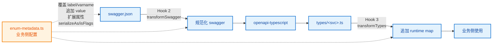

# 枚举类型生成方案

> 解决 ABP / Swashbuckle 后端 swagger 枚举不规范问题。通过 genapi hooks 扩展点交给业务侧自定义，**内核不做枚举处理**，保持工具通用性。

## 一、问题背景

### 1.1 现象

后端 ABP 自动生成的 swagger 里，枚举存在多种形态，其中部分违反 OpenAPI 规范（`enum` 值类型必须与 `type` 字段一致）：

| 类                 | swagger 写法                                  | openapi-typescript 默认产物 | 业务可读性  | 类型与运行时一致                   |
| ------------------ | --------------------------------------------- | --------------------------- | ----------- | ---------------------------------- |
| **A** 纯数字       | `type: integer` + `enum: [0,1,2]`             | `0 \| 1 \| 2`               | ❌ 魔法数字 | ✅                                 |
| **B** 字符串带描述 | `type: integer` + `enum: ["Alpha(选项一)=1"]` | `"Alpha(选项一)=1" \| ...`  | ✅ 有中文   | ❌ TS 说传字符串，后端实际收发数字 |
| **C** 纯字符串     | `type: string` + `enum: ["男","女"]`          | `"男" \| "女"`              | ✅          | ✅                                 |
| **D** 字符串无描述 | `type: string` + `enum: ["Alpha","Beta"]`     | `"Alpha" \| "Beta"`         | ⚠️          | ✅                                 |

B 类是某类遗留服务的常见形态，多组服务 swagger 里绝大多数枚举是 `Name(中文)=数字` 形态。

### 1.2 B 类枚举的具体危害

```ts
// openapi-typescript 直接生成的类型
type SampleState = "Alpha(选项一)=1" | "Beta(选项二)=2";

// 业务侧使用
api.GET("/x", { query: { bg: 1 } });
// ❌ TS 编译报错：1 不能赋给 "Alpha(选项一)=1"

api.GET("/x", { query: { bg: "Alpha(选项一)=1" as any } });
// ⚠️ 能跑但类型保护失效；如果发字符串给后端，ABP 反序列化 int 字段直接 400
```

类型与运行时的矛盾让业务侧只能 `as any`，等于失去类型保护。

### 1.3 为什么后端不改

ABP 的 `DescribeAllEnumsAsStrings` + `StringEnumConverter` 配置混乱是历史遗留，改配置要协调多个子项目、回归测试成本高。**前端 codegen 必须自己兜底**。

### 1.4 为什么内核不做

xapiforge 是**框架无关的通用 HTTP 客户端 + OpenAPI codegen 工具**。ABP / SpringBoot / NestJS 等后端框架的特殊 swagger 形态不属于工具内核职责，应通过 genapi 的 **hooks 扩展点**由业务侧自定义处理。内核只做规范 OpenAPI 的标准处理。

这样做的好处：

- 内核保持精简，不耦合任何后端框架假设
- 业务侧有完全的控制权，可以处理任意非标准形态
- 不同业务线可以共享同一套 hooks，也可以各自定制

---

## 二、方案总览：genapi hooks 扩展点



两个关键 hook：

| Hook                          | 时机                                      | 输入                        | 输出                            | 职责                                                                                       |
| ----------------------------- | ----------------------------------------- | --------------------------- | ------------------------------- | ------------------------------------------------------------------------------------------ |
| **Hook 2 · transformSwagger** | swagger 读入后、openapi-typescript 调用前 | `swagger: unknown, ctx`     | `unknown`（规范化后的 swagger） | 把非标准枚举规范化为标准 OpenAPI（`enum: [number]` + `x-enum-varnames` + `x-enum-labels`） |
| **Hook 3 · transformTypes**   | 类型生成后、写盘前                        | `typesContent: string, ctx` | `string`（追加后的内容）        | 在 `types/<svc>.ts` 末尾追加 runtime enum map、label 映射、扩展属性、工具函数              |

业务侧通过 `enum-metadata.ts` 配置文件给 hook 提供覆盖/扩展数据，hook 读取后合并到产物。

---

## 三、Hook 2:swagger 规范化（业务侧 transformSwagger）

### 3.1 处理规则

扫 `components.schemas`，对每个含 `enum` 且 `type: integer` 的 schema：

1. 尝试用宽松正则解析每个 enum 元素：`^([^(]+)(?:\(([^)]*)\))?=(.+)$`
   - 捕获 1：varname（如 `Alpha`）
   - 捕获 2：label（如 `选项一`，可能为空）
   - 捕获 3：value（如 `1`）
2. **保守策略**：任一元素不匹配 → 整个 schema 跳过，不动原值（避免破坏边界 case）
3. 全部匹配 → 写回 swagger：`enum: [1, 2]` + `x-enum-varnames: ["Alpha", "Beta"]` + `x-enum-labels: ["选项一", "选项二"]`

### 3.2 isFlags 特殊处理

若 `enum-metadata.ts` 标了 `isFlags: true`：

- 类型层用 `number`（支持组合值如 `5 = Read | Execute`，union 表达不了）
- 删除 `schema.enum`，让 openapi-typescript 生成 `number`
- 保留 `x-enum-*`，让 Hook 3 仍能生成 runtime map（按单值索引，业务侧可用 map 反查组合）

### 3.3 规范化产物示例

```json
{
  "Example.Sample.State": {
    "type": "integer",
    "format": "int32",
    "description": "状态示例",
    "enum": [1, 2],
    "x-enum-varnames": ["Alpha", "Beta"],
    "x-enum-labels": ["选项一", "选项二"]
  }
}
```

**注意**：Hook 2 不改原 swagger.json，genapi 内核会把 hook 返回的 swagger 写到临时文件喂给 openapi-typescript，原文件不动。

---

## 四、Hook 3:类型生成后处理（业务侧 transformTypes）

### 4.1 产物形态

Hook 3 在 `types/<svc>.ts` 末尾追加以下产物（每个规范化枚举一组）：

```ts
// ============ runtime enum map（业务侧 Hook 3 注入）============

// 1. const object：name → value（业务侧用常量替代魔法数字）
export const ExampleSampleState = {
  Alpha: 1,
  Beta: 2
} as const;

// 2. type alias：数字 union（与 openapi-typescript 生成的一致，业务侧二选一）
export type ExampleSampleState = 1 | 2;

// 3. label 映射：value → label（详情页展示）
export const ExampleSampleStateLabels: Record<ExampleSampleState, string> = {
  1: "选项一",
  2: "选项二"
} as const;

// 4. name 映射：value → varname（日志/调试用）
export const ExampleSampleStateNames: Record<ExampleSampleState, string> = {
  1: "Alpha",
  2: "Beta"
} as const;

// 5. ByLabel 反查：label → value（表单 Select 选了 label 要拿 value 发请求）
export const ExampleSampleStateByLabel: Record<string, ExampleSampleState> = {
  选项一: 1,
  选项二: 2
} as const;

// 6. 工具函数：取 label，未知值返回「未知」（后端响应超出已知范围时兜底）
export function getExampleSampleStateLabel(v: ExampleSampleState | number | null | undefined): string {
  if (v === null || v === undefined) return "未知";
  return (ExampleSampleStateLabels as Record<number, string>)[v] ?? "未知";
}

// 7. 工具函数：取 varname，未知值返回「Unknown」
export function getExampleSampleStateName(v: ExampleSampleState | number | null | undefined): string {
  if (v === null || v === undefined) return "Unknown";
  return (ExampleSampleStateNames as Record<number, string>)[v] ?? "Unknown";
}

// 8. 扩展属性（选项二/图标/单位等，从 enum-metadata.ts 来）
export const ExampleSampleStateColors: Record<ExampleSampleState, string | null> = {
  1: "token.primary",
  2: "token.warning"
} as const;

export const ExampleSampleStateIcon: Record<ExampleSampleState, string | null> = {
  1: "IconAlpha",
  2: "IconBeta"
} as const;

// 9. serializeAs="string" 时额外生成（给 net middleware 用）
export const ExampleSampleStateSerialize: Record<ExampleSampleState, string> = {
  1: "1",
  2: "2"
} as const;
export const ExampleSampleStateDeserialize: Record<string, ExampleSampleState> = {
  "1": 1,
  "2": 2
} as const;
```

### 4.2 设计要点

- **Hook 3 独立工作**：从原 swagger 重新解析，不依赖 Hook 2 的临时文件副作用
- **type alias 与 openapi-typescript 不冲突**：openapi-typescript 生成 `components["schemas"]["Example.Sample.State"]: 1 | 2`（在 namespace 内），Hook 3 生成顶层 export 的 `ExampleSampleState`（去点号），名字不同
- **未配置扩展属性的 value 用 `null` 占位**：保持 `Record<EnumType, ...>` 完整性，业务侧不需要做 null 检查（除非显式判断）
- **getLabel/getName 带兜底**：后端响应值超出已知范围（如新增了枚举但前端 swagger 没更新）时不报错，返回「未知」/「Unknown」

---

## 五、enum-metadata.ts 配置（五类场景）

业务侧在 `hooks/enum-metadata.ts` 维护枚举元数据注册表，hook 读取后合并到产物。

### 5.1 配置接口

```ts
export interface EnumMetadata {
  /** 覆盖 label（按 value 索引）—— 后端 label 不准/写错/空白时 */
  overrideLabels?: Record<number, string>;
  /** 覆盖 varname（按 value 索引）—— 后端 varname 拼错/大小写不规范时 */
  overrideVarnames?: Record<number, string>;
  /** 追加缺失的枚举值 —— 后端漏了某个值，业务侧补 */
  appendValues?: Array<{ name: string; label: string; value: number }>;
  /** 业务侧扩展属性（展示 token、图标等）—— 后端 swagger 没有这些字段 */
  extensions?: Record<string, Record<number, unknown>>;
  /** 序列化方式：后端收发字符串而 swagger 声明 integer（ABP 老接口偶发） */
  serializeAs?: "number" | "string";
  /** 是否位运算枚举（[Flags] 多选值，union 表达不了组合） */
  isFlags?: boolean;
}

export const enumMetadata: Record<string, EnumMetadata> = {
  // key 是 swagger schema 全名
};
```

### 5.2 五类配置场景

#### 场景 1：扩展属性（选项二/图标/单位）

后端 swagger 没有选项二、图标、单位字段，业务侧补：

```ts
"Example.Sample.State": {
  extensions: {
    colors: { 1: "token.primary", 2: "token.warning" },
    icon: { 1: "IconAlpha", 2: "IconBeta" },
  },
},
"Example.Sample.Level": {
  extensions: {
    tone: { 1: "neutral", 2: "accent", 3: "muted" },
  },
},
```

生成的产物：`ExampleSampleStateColors` / `ExampleSampleStateIcon` / `ExampleSampleLevelTone`。

#### 场景 2：覆盖后端 label（不准确/空白）

后端 label 写错或太简，业务侧覆盖：

```ts
"Example.Sample.Category": {
  overrideLabels: {
    0: "分类一（覆盖示例）",  // 后端只写「分类一」
    1: "分类二（覆盖示例）",
  },
},
```

#### 场景 3：追加缺失的枚举值

后端漏了某个枚举值（示例追加），业务侧补：

```ts
"Example.Sample.ProcessState": {
  appendValues: [
    { name: "Archived", label: "已归档", value: 4 },
  ],
},
```

冲突检测：追加的 value 与已有 value 冲突时，hook warn 并跳过。

#### 场景 4：serializeAs（后端收发字符串）

后端实际收发字符串 `"1"`，但 swagger 写错成 `integer`。前端类型仍用数字 union（业务侧写 `1` 顺手），但额外生成 Serialize/Deserialize map，供 net middleware 在 onRequest/onResponse 自动转换：

```ts
"Example.Sample.State": {
  serializeAs: "string",
  // ...其他分类配置
},
```

生成产物：

```ts
export const ExampleSampleStateSerialize: Record<ExampleSampleState, string> = {
  1: "1",
  2: "2"
} as const;
export const ExampleSampleStateDeserialize: Record<string, ExampleSampleState> = {
  "1": 1,
  "2": 2
} as const;
```

#### 场景 5：isFlags 位运算枚举

C# `[Flags] enum Permission { Read=1, Write=2, Execute=4 }`，后端可能返回 `5 = Read | Execute`，union `1|2|4` 类型层报错。配 `isFlags: true`：

```ts
"Example.Sample.Permission": {
  isFlags: true,
  extensions: {
    colors: { 1: "#52c41a", 2: "#1677ff", 4: "#fa8c16" },
  },
},
```

生成产物：

- 类型用 `number`（支持组合值）
- runtime map 仍按单值索引，业务侧可用 map 反查组合

---

## 六、运行时使用七场景

### 6.1 代码里引用常量（替代魔法数字）

```ts
import { ExampleSampleState } from "@/api/demo/types/monitor";

api.PUT("/api/monitor/config", {
  body: { background: ExampleSampleState.Alpha } // = 1
});
```

### 6.2 反查 label（详情页展示）

```ts
import { ExampleSampleStateLabels } from "@/api/demo/types/monitor";

const label = ExampleSampleStateLabels[row.background]; // "选项一"
```

或用带兜底的工具函数（后端响应值超出已知范围时不报错）：

```ts
import { getExampleSampleStateLabel } from "@/api/demo/types/monitor";

const label = getExampleSampleStateLabel(row.background); // "选项一" 或 "未知"
```

### 6.3 下拉框 options

```ts
import { ExampleSampleState, ExampleSampleStateLabels } from "@/api/demo/types/monitor";

const options = Object.entries(ExampleSampleState).map(([name, value]) => ({
  value,
  label: ExampleSampleStateLabels[value]
}));
// [{ value: 1, label: "选项一" }, { value: 2, label: "选项二" }]
```

### 6.4 表单 Select 选了 label 要拿 value 发请求

```ts
import { ExampleSampleStateByLabel } from "@/api/demo/types/monitor";

// 用户在下拉框选了「选项一」
const selectedLabel = "选项一";
const value = ExampleSampleStateByLabel[selectedLabel]; // 1
api.POST("/api/monitor/config", { body: { background: value } });
```

### 6.5 用扩展属性渲染（选项二/图标）

```ts
import {
  ExampleSampleStateColors,
  ExampleSampleStateIcon,
} from "@/api/demo/types/monitor";

// 渲染标签
<Tag color={ExampleSampleStateColors[row.background]}>
  <Icon type={ExampleSampleStateIcon[row.background]} />
  {getExampleSampleStateLabel(row.background)}
</Tag>
```

### 6.6 响应值超出已知范围（兜底）

后端新增了枚举值 `3` 但前端 swagger 没更新，直接用 `Labels[3]` 会拿到 `undefined`：

```ts
import { getExampleSampleStateLabel } from "@/api/demo/types/monitor";

const label = getExampleSampleStateLabel(3); // "未知"（不报错）
```

### 6.7 后端收发字符串（serializeAs + middleware）

后端实际收发 `"1"` 字符串，swagger 写错成 `integer`。前端类型按数字用，运行时由 net middleware 自动转换：

```ts
// middleware/enum-coerce.ts
import type { Middleware } from "@xapiforge/core";
import { ExampleSampleStateSerialize } from "@/api/demo/types/monitor";

export const enumSerializeMiddleware: Middleware = {
  async onRequest({ request }) {
    const body = await request.clone().json();
    // 把数字 1 转字符串 "1" 发请求
    const transformed = {
      ...body,
      background: body.background !== undefined ? ExampleSampleStateSerialize[body.background as 1 | 2] : undefined
    };
    return new Request(request, { body: JSON.stringify(transformed) });
  },
  async onResponse({ response }) {
    // 把响应里的字符串 "1" 转回数字 1
    // ...
  }
};

// 使用
const api = createNet({
  baseURL,
  authService,
  middleware: [enumSerializeMiddleware]
});
```

> middleware 可按业务协议自行实现；这里仅展示 Serialize/Deserialize map 的产物形态。

---

## 七、示例产物对照

以 Example Demo 项目 `Example.Sample.State` 为例，示例生成产物：

| 产物                                            | 值                                           | 来源                                  |
| ----------------------------------------------- | -------------------------------------------- | ------------------------------------- |
| `ExampleSampleState`（const object）            | `{ Alpha: 1, Beta: 2 }`                      | Hook 3                                |
| `ExampleSampleState`（type alias）              | `1 \| 2`                                     | Hook 3                                |
| `ExampleSampleStateLabels`                      | `{ 1: "选项一", 2: "选项二" }`               | Hook 3（x-enum-labels）               |
| `ExampleSampleStateNames`                       | `{ 1: "Alpha", 2: "Beta" }`                  | Hook 3（x-enum-varnames）             |
| `ExampleSampleStateByLabel`                     | `{ "选项一": 1, "选项二": 2 }`               | Hook 3                                |
| `getExampleSampleStateLabel(v)`                 | `"选项一"` / `"未知"`                        | Hook 3                                |
| `getExampleSampleStateName(v)`                  | `"Alpha"` / `"Unknown"`                      | Hook 3                                |
| `ExampleSampleStateColors`                      | `{ 1: "token.primary", 2: "token.warning" }` | Hook 3（enum-metadata.ts extensions） |
| `ExampleSampleStateIcon`                        | `{ 1: "IconAlpha", 2: "IconBeta" }`          | Hook 3（enum-metadata.ts extensions） |
| `components["schemas"]["Example.Sample.State"]` | `1 \| 2`                                     | openapi-typescript（Hook 2 规范化后） |

示例验证输出：

- `core`：N 个枚举规范化
- `extra`：M 个枚举规范化
- `reporting`：K 个枚举规范化
- `ops`：L 个枚举规范化（含 appendValues 追加示例值）
- `audit`：P 个枚举规范化
- `base`/`env`/`file`/`msg`：未配置 hooks（service 级 `hooks: {}` 覆盖），走默认

tsc 全通过，无类型冲突。

---

## 八、设计决策

### 8.1 为什么用 hooks 而不是内核内置

| 维度       | 内核内置                     | hooks 扩展点                 |
| ---------- | ---------------------------- | ---------------------------- |
| 通用性     | ❌ 假设所有后端都是 ABP 形态 | ✅ 框架无关，业务侧自定义    |
| 内核复杂度 | ❌ 加 ~640 行枚举处理代码    | ✅ 内核只提供 hook 调用点    |
| 业务灵活度 | ❌ 只能处理预定义的几种形态  | ✅ 任意非标准形态都能处理    |
| 跨项目复用 | ⚠️ 配置项膨胀                | ✅ 不同业务线共享/定制 hooks |

### 8.2 为什么 Hook 3 追加到 types 而不是单独 enums 目录

- 避免新增目录管理复杂度
- 业务侧 import 路径统一：`from "@/api/<project>/types/<svc>"`
- type alias 与 const object 同名，业务侧按需 import

### 8.3 为什么 type alias 重复定义不冲突

openapi-typescript 生成的 `components["schemas"]["Example.Sample.State"]: 1 | 2` 在 `components` namespace 内，Hook 3 生成的 `export type ExampleSampleState = 1 | 2` 是顶层 export，**名字不同**（去点号 vs 带点号的 namespace 路径），不冲突。

### 8.4 为什么 getLabel/getName 生成工具函数而不是业务侧自己写

- 业务侧自己写要每个枚举写一遍 `?? "未知"`，重复
- 工具函数集中兜底逻辑，业务侧直接调用
- 后端响应值超出已知范围时不报错，提升健壮性

### 8.5 为什么 isFlags 类型用 number 而不是 union

`[Flags] enum` 可能返回组合值（如 `5 = Read | Execute`），TS union `1|2|4` 表达不了 `5`，类型层会报错。用 `number` 牺牲精度换兼容，业务侧用 runtime map 反查组合。

### 8.6 为什么 serializeAs 类型仍用数字 union

前端业务代码写 `1` 比写 `"1"` 顺手，类型层保留数字 union，运行时由 net middleware 自动转换字符串。这样业务侧代码无感知，类型保护不失效。

---

## 九、相关文档

- [genapi hooks 设计](./genapi-hooks.md) — 完整 hooks 扩展点文档（6 个 hook）
- [架构分层](../internals/layered-architecture.md) — xapiforge 整体架构
