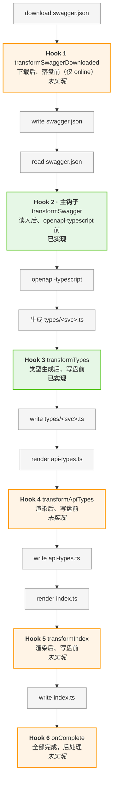

# genapi Hooks（业务自定义扩展点）

> **状态：Hook 2 + Hook 3 已实现**（MVP）。Hook 1/4/5/6 按需追加。
>
> **设计原则**：xapiforge 是通用工具，后端框架（ABP / SpringBoot / NestJS 等）的特殊 swagger 形态不属于内核职责。内核通过 hooks 暴露扩展点，业务侧自行注入定制逻辑。

## 一、为什么需要 hooks

不同后端框架生成的 swagger 有各种「不规范」形态：

| 后端框架          | 不规范表现                                                                              |
| ----------------- | --------------------------------------------------------------------------------------- |
| ABP (C#)          | 枚举 `"Alpha(选项一)=1"`、`Volo.Abp.*` schema 污染、`/api/abp/*` 端点泄漏、`int64` 精度 |
| SpringBoot (Java) | `Page<T>` 包装类型膨胀、`Map<String, Object>` 丢类型                                    |
| NestJS (Node)     | 自定义 decorator 产生的 `x-` 扩展字段                                                   |

这些不是 xapiforge 内核该处理的——内核只吃**规范 OpenAPI**，产出标准 TS 类型。

## 二、Hook 接口

### 2.1 已实现的 Hook

```ts
// packages/genapi/src/index.ts

/** Hook 上下文（所有 hook 共用） */
export interface GenapiHookContext {
  projectId: string;
  serviceName: string;
  /** 原 swagger 文件绝对路径（hooks 仅读，不修改原文件） */
  swaggerPath: string;
  /** 类型产物绝对路径 types/<svc>.ts */
  typesPath: string;
}

/** Hook 2 · 主钩子：swagger.json 读入后、openapi-typescript 调用前 */
export type TransformSwaggerHook = (swagger: unknown, ctx: GenapiHookContext) => Promise<unknown>;

/** Hook 3：类型生成后、写盘前 */
export type TransformTypesHook = (typesContent: string, ctx: GenapiHookContext) => Promise<string>;

export interface GenapiHooks {
  transformSwagger?: TransformSwaggerHook;
  transformTypes?: TransformTypesHook;
}
```

### 2.2 完整 Hook 路线图

6 个 hook 插入点，已实现 2 个，其余按需追加：



Hook 2 是主钩子：在线 / 离线模式都触发，是业务定制 swagger 的唯一权威入口。

### 2.3 配置位置：顶层 vs service 级

`XApiForgeConfig` 顶层和 `ServiceConfig` 都支持 `hooks` 字段，**service 级覆盖顶层**：

```ts
export interface XApiForgeConfig {
  // ... 其它字段
  /** 顶层默认 hooks：所有 service 共享 */
  hooks?: GenapiHooks;
}

export interface ServiceConfig {
  // ... 其它字段
  /**
   * service 级 hooks（可选，覆盖 XApiForgeConfig.hooks）。
   * 合并策略：覆盖式（svc.hooks ?? config.hooks）。
   * service 级传 {} 表示「显式禁用所有 hook」。
   */
  hooks?: GenapiHooks;
}
```

**合并策略**：`svc.hooks ?? config.hooks`

| 场景                   | 配置                              | 效果                       |
| ---------------------- | --------------------------------- | -------------------------- |
| 同公司框架统一（90%）  | 顶层配 hooks，service 不配        | 所有 service 继承顶层 hook |
| 跨框架特殊服务         | 顶层配 hooks，某 service 配 `{}`  | 该 service 跳过所有 hook   |
| 混合框架（个别自定义） | 顶层配 hooks，某 service 配自定义 | 该 service 用自己的 hook   |

---

## 三、Hook 内部实现要点

### 3.1 Hook 2: transformSwagger（主钩子）

**触发位置**：`generate()` 内，读 swagger JSON 后、调 `runOpenapiTypescript` 前。

**关键**：变换后的 JSON 写到**临时文件**（系统 tmpdir），openapi-typescript 读临时文件。磁盘上的原版 swagger 不被修改，生成完删临时文件。

```ts
// packages/genapi/src/index.ts（简化示意）
const resolveHooks = (svc: ServiceConfig): GenapiHooks | undefined => (svc.hooks !== undefined ? svc.hooks : opts.hooks);

for (const svc of project.services) {
  const swaggerFile = join(swaggerDir, `${svc.name}.json`);
  const hooks = resolveHooks(svc);

  // Hook 2：transformSwagger
  const inputFile = await applyTransformSwagger(swaggerFile, svc.name, hooks, ctx);
  try {
    runOpenapiTypescript(inputFile, typeFile);
  } finally {
    // 如果 hook 写了临时文件，删除（原文件不动）
    if (inputFile !== swaggerFile) {
      await rm(inputFile, { force: true });
    }
  }

  // Hook 3：transformTypes
  if (hooks?.transformTypes) {
    const original = await readFile(typeFile, "utf8");
    const transformed = await hooks.transformTypes(original, ctx);
    if (transformed !== original) {
      await writeFile(typeFile, transformed, "utf8");
    }
  }
}
```

`applyTransformSwagger` 内部：

```ts
async function applyTransformSwagger(swaggerFile, serviceName, hooks, ctx): Promise<string> {
  if (!hooks?.transformSwagger) return swaggerFile; // 无 hook 直接用原文件

  const original = await readFile(swaggerFile, "utf8");
  const parsed = JSON.parse(original);
  const transformed = await hooks.transformSwagger(parsed, ctx);
  if (transformed == null) {
    throw new Error(`transformSwagger(${serviceName}) 返回空值`);
  }

  // 写入系统 tmpdir，避免污染原 swagger 目录
  const tmpFile = join(tmpdir(), `genapi-${projectId}-${serviceName}-${randomBytes(6).toString("hex")}.json`);
  await writeFile(tmpFile, JSON.stringify(transformed, null, 2), "utf8");
  return tmpFile;
}
```

### 3.2 Hook 3: transformTypes

**触发位置**：`runOpenapiTypescript` 后、`writeFile(typeFile)` 前。

**关键**：Hook 3 独立从原 swagger 重新解析，不依赖 Hook 2 的临时文件副作用。这样即使只配 Hook 3 也能工作，两个 hook 解耦。

---

## 四、实战示例：Example 枚举规范化（完整脱敏场景）

下面是一个脱敏业务案例，覆盖三类典型场景。以下代码为文档内的脱敏示例。

### 4.1 背景

Example 示例后端（ABP 框架）的 swagger 把数字枚举写成字符串带括号带等号格式：

```json
{
  "Example.Sample.State": {
    "type": "integer",
    "enum": ["Alpha(选项一)=1", "Beta(选项二)=2"]
  }
}
```

openapi-typescript 不识别这种格式，会生成字符串 union `"Alpha(选项一)=1" | "Beta(选项二)=2"`，丢失「数字」语义。

### 4.2 三类业务需求

| 场景              | 需求                                           | 配置方式                                     |
| ----------------- | ---------------------------------------------- | -------------------------------------------- |
| 1. 扩展属性       | 给枚举配展示 token 或图标（后端 swagger 没有） | `extensions: { colors: {...}, icon: {...} }` |
| 2. 覆盖后端 label | 后端 label 不准，业务侧覆盖                    | `overrideLabels: { 0: "更准的描述" }`        |
| 3. 追加缺失值     | 后端漏了某个枚举值（示例追加）                 | `appendValues: [{ name, label, value }]`     |

### 4.3 业务侧配置文件

```ts
// hooks/enum-metadata.ts
export interface EnumMetadata {
  /** 覆盖 label（按 value 索引） */
  overrideLabels?: Record<number, string>;
  /** 覆盖 varname（按 value 索引） */
  overrideVarnames?: Record<number, string>;
  /** 追加缺失的枚举值（冲突时 warning 并跳过） */
  appendValues?: Array<{ name: string; label: string; value: number }>;
  /** 业务侧扩展属性（展示 token、图标等） */
  extensions?: Record<string, Record<number, unknown>>;
}

export const enumMetadata: Record<string, EnumMetadata> = {
  // 场景 1：扩展属性（展示 token、图标）
  "Example.Sample.State": {
    extensions: {
      colors: { 1: "token.primary", 2: "token.warning" },
      icon: { 1: "IconAlpha", 2: "IconBeta" }
    }
  },

  // 场景 1（部分 value 有配置，其它给 null 占位）
  "Example.Sample.Level": {
    extensions: {
      tone: { 1: "neutral", 2: "accent", 3: "muted" } // 其它值自动填 null
    }
  },

  // 场景 2：覆盖后端 label
  "Example.Sample.Category": {
    overrideLabels: {
      0: "分类一（覆盖示例）",
      1: "分类二（覆盖示例）"
    }
  },

  // 场景 3：追加缺失的枚举值
  "Example.Sample.ProcessState": {
    appendValues: [{ name: "Archived", label: "已归档", value: 4 }]
  }
};
```

### 4.4 业务侧 Hook 实现

```ts
// hooks/normalize-example-enums.ts（简化版，完整版见实际文件）
import { enumMetadata, type EnumMetadata } from "./enum-metadata.js";

// 宽松正则，支持三档格式：
//   "Alpha(选项一)=1"             →  name=Alpha, label=选项一, value=1
//   "Alpha=1"                   →  name=Alpha, label="",    value=1
//   "Alpha()=1"                 →  name=Alpha, label="",    value=1
//   "TYPE_A(嵌套说明(示例))=7"  →  name=TYPE_A, label=嵌套说明(示例), value=7  （嵌套括号）
//
// 注意：label 部分用贪婪 .* 而非 [^)]*，否则嵌套括号的 label 会被截断。
// 例如 "TYPE_A(嵌套说明(示例))=7" 用 [^)]* 会解析成 label="嵌套说明(示例"（漏一个右括号）。
const EXAMPLE_ENUM_PATTERN = /^([^(]+)(?:\((.*)\))?=(.+)$/;

function tryNormalize(rawEnum: unknown[], type: unknown): NormalizedEnum | null {
  if (type !== "integer") return null; // type=string 的字符串枚举是合法的，不动
  if (rawEnum.length === 0) return null;

  const values: number[] = [];
  const varnames: string[] = [];
  const labels: string[] = [];

  for (const item of rawEnum) {
    if (typeof item === "number") return null; // 已是数字数组，跳过
    if (typeof item !== "string") return null;
    const m = item.match(EXAMPLE_ENUM_PATTERN);
    if (!m) return null; // 不全匹配 → 保守跳过整个 schema
    values.push(Number(m[3]));
    varnames.push(m[1].trim());
    labels.push(m[2]?.trim() ?? "");
  }
  return { values, varnames, labels };
}

/** 应用业务侧 metadata 覆盖 */
function applyMetadata(info, meta: EnumMetadata | undefined, schemaName: string): void {
  if (!meta) return;
  // 1. 覆盖 label
  if (meta.overrideLabels) {
    for (let i = 0; i < info.values.length; i++) {
      const v = info.values[i];
      if (v !== undefined && v in meta.overrideLabels) {
        const override = meta.overrideLabels[v];
        if (override !== undefined) info.labels[i] = override;
      }
    }
  }
  // 2. 覆盖 varname（同上）
  // 3. 追加值（冲突检测）
  if (meta.appendValues) {
    for (const append of meta.appendValues) {
      if (info.values.includes(append.value)) {
        console.warn(`  [normalize-example-enums] appendValues 冲突: schema=${schemaName} value=${append.value} 已存在，跳过`);
        continue;
      }
      info.values.push(append.value);
      info.varnames.push(append.name);
      info.labels.push(append.label);
    }
  }
}

// Hook 2：规范化 swagger
export const normalizeExampleEnumsHook: GenapiHooks["transformSwagger"] = (swagger, ctx) => {
  const { cloned, enums } = scanAndNormalize(swagger); // 内部调用 tryNormalize + applyMetadata
  if (enums.length > 0) {
    console.log(`  [normalize-example-enums/${ctx.serviceName}] 规范化 ${enums.length} 个非标准枚举 schema`);
  }
  return Promise.resolve(cloned);
};

// Hook 3：注入 runtime enum map + 扩展属性
export const injectEnumMapsHook: GenapiHooks["transformTypes"] = async (typesContent, ctx) => {
  const original = await readFile(ctx.swaggerPath, "utf8");
  const { enums } = scanAndNormalize(JSON.parse(original));
  if (enums.length === 0) return typesContent;

  // 生成 const + type + labels + names + 每个扩展属性一个 map
  return typesContent + enums.map(buildEnumBlock).join("\n");
};

export const exampleHooks: GenapiHooks = {
  transformSwagger: normalizeExampleEnumsHook,
  transformTypes: injectEnumMapsHook
};
```

### 4.5 Swagger 配置

```ts
// xapiforge.config.ts
import { exampleHooks } from "./hooks/normalize-example-enums.js";

export const xapiForgeConfig: XApiForgeConfig = {
  // ...
  hooks: exampleHooks, // 顶层默认 hooks
  projects: [
    {
      name: "demo",
      displayName: "Example Demo（多服务）",
      services: [
        // base 演示 service 级覆盖：禁用所有 hook
        { name: "base", displayName: "Base（演示禁用）", port: 0, hooks: {} },
        // 其它服务继承顶层 exampleHooks
        { name: "core", displayName: "Core Sample", port: 0 }
        // ...
      ]
    }
  ]
};
```

### 4.6 示例产物对照

跑 `pnpm generate:api` 后，示例项目的多个服务均生成成功。三类场景产物对照：

#### 场景 1：扩展属性

原 swagger：`"Example.Sample.State": { enum: ["Alpha(选项一)=1", "Beta(选项二)=2"], type: "integer" }`

生成 `types/core.ts`：

```ts
// openapi-typescript 产物（Hook 2 规范化后）
"Example.Sample.State": 1 | 2;

// Hook 3 注入的四件套 + 扩展属性
export const ExampleSampleState = { Alpha: 1, Beta: 2 } as const;
export type  ExampleSampleState = 1 | 2;
export const ExampleSampleStateLabels: Record<ExampleSampleState, string> = {
  1: "选项一", 2: "选项二"
} as const;
export const ExampleSampleStateNames: Record<ExampleSampleState, string> = {
  1: "Alpha", 2: "Beta"
} as const;
// 扩展属性：展示 token
export const ExampleSampleStateColors: Record<ExampleSampleState, string | null> = {
  1: "token.primary", 2: "token.warning"
} as const;
// 扩展属性：图标
export const ExampleSampleStateIcon: Record<ExampleSampleState, string | null> = {
  1: "IconAlpha", 2: "IconBeta"
} as const;
```

**部分 value 有配置的扩展属性**（SampleLevel 的 tone）：

```ts
export const ExampleSampleLevelTone: Record<ExampleSampleLevel, string | null> = {
  1: "neutral", // LevelOne
  2: "accent", // LevelTwo
  3: "muted", // LevelThree
  4: null, // 未配置 → null 占位
  5: null
  // ... 12: null
} as const;
```

设计决策：未配置的 value 用 `null` 而非省略，保证 `Record<T, string | null>` 类型完整，业务侧 `tone[t]` 永远有值（要么配置值要么 null），不需要 `undefined` 检查。

#### 场景 2：覆盖后端 label

原 swagger label「分类一」太简，业务侧覆盖成「分类一（覆盖示例）」：

```ts
export const ExampleSampleCategoryLabels: Record<ExampleSampleCategory, string> = {
  0: "分类一（覆盖示例）", // ← overrideLabels 覆盖
  1: "分类二（覆盖示例）", // ← overrideLabels 覆盖
  2: "分类三", // ← 后端原值
  10: "其他分类" // ← 后端原值
} as const;
```

#### 场景 3：追加缺失的枚举值

后端 `SampleProcessState` 少了一个演示值，业务侧通过配置追加：

```ts
export const ExampleSampleProcessState = {
  Initial: 0,
  InProgress: 1,
  Done: 2,
  Closed: 3,
  Archived: 4              // ← appendValues 追加示例值
} as const;

export type ExampleSampleProcessState = 0 | 1 | 2 | 3 | 4;  // ← union 也补齐

// openapi-typescript 产物也跟着变了（Hook 2 把 appendValues 写回 swagger）
"Example.Sample.ProcessState": 0 | 1 | 2 | 3 | 4;
```

#### service 级覆盖演示

`base` 服务配置 `hooks: {}`，原样喂给 openapi-typescript 不做规范化：

```
[normalize-example-enums/monitor]   规范化 N 个非标准枚举 schema
[normalize-example-enums/reservoir] 规范化 M 个非标准枚举 schema
[normalize-example-enums/safety]    规范化 K 个非标准枚举 schema
[normalize-example-enums/workflow]  规范化 L 个非标准枚举 schema
（base 不出现 → hooks:{} 覆盖生效）
```

base 产物保留原始字符串枚举 `"X(label)=1"`。

### 4.7 业务侧使用

```ts
import {
  ExampleSampleState,
  ExampleSampleStateLabels,
  ExampleSampleStateColors,
} from "./types/monitor.js";

const t: ExampleSampleState = 1;             // 类型 = 1
const v = ExampleSampleState.Alpha;          // 常量 = 1
const label = ExampleSampleStateLabels[t];   // '选项一'
const color = ExampleSampleStateColors[t];   // 'token.primary'

// 配合 UI 组件
<Select
  options={(Object.keys(ExampleSampleState) as Array<keyof typeof ExampleSampleState>).map((k) => ({
    label: ExampleSampleStateLabels[ExampleSampleState[k]],
    value: ExampleSampleState[k],
    style: { color: ExampleSampleStateColors[ExampleSampleState[k]] ?? undefined },
  }))}
/>
```

### 4.8 Edge case 防护（必读）

实际业务 swagger 的枚举值可能出现两类「看着能解析、实则崩」的 edge case。上面简化版 hook 没处理，完整版必须加防护。

#### Edge case 1：嵌套括号的 label

后端枚举值形如 `"TYPE_A(嵌套说明(示例))=7"`，label 内部有括号。

**错误写法**（`[^)]*` 遇到第一个 `)` 就停）：

```ts
// ❌ 会把 label 解析成 "嵌套说明(示例"（漏一个右括号）
const EXAMPLE_ENUM_PATTERN = /^([^(]+)(?:\(([^)]*)\))?=(.+)$/;
```

**正确写法**（贪婪 `.*` 配合末尾 `)=(.+)` 锚定）：

```ts
// ✅ label 部分用 .* 贪婪匹配到最后一个 `)`
const EXAMPLE_ENUM_PATTERN = /^([^(]+)(?:\((.*)\))?=(.+)$/;
```

> 正则原理：`(.*)` 贪婪会吃到行末，然后回溯找到最后一个 `)=(.+)$` 的位置。这样嵌套括号的 label 能完整保留。

#### Edge case 2：重复 label 导致 `byLabel` map 重复 key

后端枚举里多个 value 共用同一 label（例如某个枚举里两个 value 共用同一 label）。生成 `ByLabel` 反查 map 时会出现：

```ts
// ❌ 生成的代码有 TS1117 错误
export const ExampleSampleNumberKindByLabel: Record<string, ExampleSampleNumberKind> = {
  重复标签示例: 1,
  重复标签示例: 2 // ← TS1117: An object literal cannot have multiple properties with the same name
} as const;
```

**防护**：生成 `ByLabel` 时用 `Map` 去重，label 冲突时保留第一个 value（先到先得）：

```ts
// ✅ 去重后再生成
const byLabelDedup = new Map<string, number>();
for (let i = 0; i < e.values.length; i++) {
  const v = e.values[i]!;
  const label = e.labels[i]!;
  if (!byLabelDedup.has(label)) byLabelDedup.set(label, v);
}
const byLabelEntries = Array.from(byLabelDedup.entries())
  .map(([label, v]) => `  ${JSON.stringify(label)}: ${v}`)
  .join(",\n");
```

#### 完整的 `buildEnumBlock` 防护版

```ts
function buildEnumBlock(e: EnumSchemaInfo): string {
  const lines: string[] = [];
  const tsName = e.tsName;
  const union = e.isFlags ? "number" : e.values.join(" | ");

  // const + type
  const constEntries = e.varnames.map((n, i) => `  ${n}: ${e.values[i]}`).join(",\n");
  lines.push(`export const ${tsName} = {`, constEntries, `} as const;`, ``);
  lines.push(`export type ${tsName} = ${union};`, ``);

  // labels map（value → label）
  const labelEntries = e.values.map((v, i) => `  ${v}: ${JSON.stringify(e.labels[i])}`).join(",\n");
  lines.push(`export const ${tsName}Labels: Record<${tsName}, string> = {`, labelEntries, `} as const;`, ``);

  // names map（value → varname）
  const nameEntries = e.values.map((v, i) => `  ${v}: ${JSON.stringify(e.varnames[i])}`).join(",\n");
  lines.push(`export const ${tsName}Names: Record<${tsName}, string> = {`, nameEntries, `} as const;`, ``);

  // byLabel map（label → value）—— 必须去重，否则重复 label 会导致 TS1117
  const byLabelDedup = new Map<string, number>();
  for (let i = 0; i < e.values.length; i++) {
    const v = e.values[i]!;
    const label = e.labels[i]!;
    if (!byLabelDedup.has(label)) byLabelDedup.set(label, v);
  }
  const byLabelEntries = Array.from(byLabelDedup.entries())
    .map(([label, v]) => `  ${JSON.stringify(label)}: ${v}`)
    .join(",\n");
  lines.push(`export const ${tsName}ByLabel: Record<string, ${tsName}> = {`, byLabelEntries, `} as const;`, ``);

  // getLabel / getName 工具函数
  lines.push(`/** 取 label，未知值返回 "未知" */`, `export function get${tsName}Label(v: ${tsName} | number | null | undefined): string {`, `  if (v === null || v === undefined) return "未知";`, `  return (${tsName}Labels as Record<number, string>)[v] ?? "未知";`, `}`, ``, `/** 取 varname，未知值返回 "Unknown" */`, `export function get${tsName}Name(v: ${tsName} | number | null | undefined): string {`, `  if (v === null || v === undefined) return "Unknown";`, `  return (${tsName}Names as Record<number, string>)[v] ?? "Unknown";`, `}`, ``);

  // ...（extensions / serializeAs 部分不变）

  return lines.join("\n");
}
```

#### 经验总结

| Edge case        | 触发场景                      | 症状                         | 防护                                          |
| ---------------- | ----------------------------- | ---------------------------- | --------------------------------------------- |
| 嵌套括号的 label | label 含 `(0-255)` 等范围说明 | label 被截断，部分枚举值丢失 | 正则用 `.*` 贪婪匹配                          |
| 重复 label       | 多个 value 共用同一中文描述   | `TS1117` 编译错误，生成失败  | `byLabel` map 用 `Map` 去重，保留第一个 value |

**原则**：hook 生成的是 TS 代码，任何「看起来能跑」的字符串拼接都可能触发 TS 编译错误。生成后跑一次 `tsc --noEmit` 是最有效的兜底。

---

## 五、其它场景示例

### 5.1 过滤 Volo.Abp.* schema 和 /api/abp/* 端点

```ts
const hooks: GenapiHooks = {
  transformSwagger(swagger, ctx) {
    const sw = swagger as any;
    // 删 Volo.Abp.* schema
    const schemas = sw.components?.schemas;
    if (schemas) {
      for (const key of Object.keys(schemas)) {
        if (key.startsWith("Volo.Abp.")) delete schemas[key];
      }
    }
    // 删 /api/abp/* 端点
    const paths = sw.paths;
    if (paths) {
      for (const path of Object.keys(paths)) {
        if (path.startsWith("/api/abp/")) delete paths[path];
      }
    }
    return Promise.resolve(sw);
  }
};
```

### 5.2 int64 → string（防精度丢失）

```ts
const hooks: GenapiHooks = {
  transformSwagger(swagger, ctx) {
    const walk = (schema: any) => {
      if (schema?.format === "int64") {
        schema.type = "string";
        delete schema.format;
      }
      for (const k of Object.keys(schema ?? {})) {
        if (typeof schema[k] === "object") walk(schema[k]);
      }
    };
    const sw = swagger as any;
    const schemas = sw.components?.schemas;
    if (schemas) for (const s of Object.values(schemas)) walk(s);
    const paths = sw.paths;
    if (paths) for (const p of Object.values(paths)) walk(p);
    return Promise.resolve(sw);
  }
};
```

> int64 精度问题需要 genapi hook + net middleware 协同：genapi 把 `int64` 改成 `string`，net 在响应解析时处理大数字。这是构建时 + 运行时的协同，不属于单个 hook 的职责。

### 5.3 SpringBoot Page<T> 解包

```ts
const hooks: GenapiHooks = {
  transformSwagger(swagger, ctx) {
    const sw = swagger as any;
    const schemas = sw.components?.schemas;
    if (!schemas) return Promise.resolve(sw);
    // 把 Page<UserDto> 的 properties 直接展开到 UserDto 的数组包装上
    for (const [name, schema] of Object.entries(schemas)) {
      if (name.startsWith("Page«") || name.startsWith("Page<")) {
        // 提取泛型参数，改写 schema...
      }
    }
    return Promise.resolve(sw);
  }
};
```

---

## 六、设计决策与取舍

### 6.1 为什么 Hook 2 是主钩子

| 候选                | 优点                                      | 缺点                                     |
| ------------------- | ----------------------------------------- | ---------------------------------------- |
| Hook 1 (下载后)     | 磁盘文件即规范版                          | 离线模式不触发；与生成解耦后调试要分两步 |
| **Hook 2 (生成时)** | **在线/离线都触发；磁盘保真；变换确定性** | 需要 temp 文件（额外 IO）                |

**选择 Hook 2**：离线模式（CI 环境无网络）也能工作；磁盘 swagger 保持原始版本便于对比调试；变换逻辑集中在 generate 流程内，确定性更强。

### 6.2 为什么 Hook 3 独立从原 swagger 重新解析

Hook 2 的产物是临时文件，生成完就删了。Hook 3 如果依赖 Hook 2 的副作用，就必须在 Hook 2 删临时文件前抢跑，时序耦合。

**选择独立解析**：Hook 3 从 `ctx.swaggerPath` 读原 swagger 重新解析。代价是解析逻辑跑两遍（约 10ms），收益是两个 hook 完全解耦，可以单独配置任何一个。

### 6.3 为什么 service 级 hooks 用覆盖式而不是叠加式

```ts
// 覆盖式（当前实现）
const hooks = svc.hooks !== undefined ? svc.hooks : config.hooks;

// 叠加式（未采用）
const hooks = mergeHooks(config.hooks, svc.hooks); // 链式调用
```

- 覆盖式：简单 + 跟 `middleware` 字段一致。service 级要完全替代就替代，要禁用就 `{}`。
- 叠加式：灵活，但 hook 顺序变成隐式契约，调试难。

**选择覆盖式**：90% 场景是同公司框架统一，service 级要么继承要么禁用，不需要叠加。

### 6.4 为什么不提供「注册多个 hook」机制

每个 hook 只支持**一个函数**，不支持数组注册。业务侧需要组合多个逻辑，在自己函数内调用：

```ts
transformSwagger(swagger, ctx) {
  return Promise.resolve(normalizeExampleEnums(swagger))
    .then(s => filterAbpNoise(s))
    .then(s => convertInt64(s));
}
```

### 6.5 为什么扩展属性未配置时给 null 而不是省略

```ts
// 给 null（当前实现）— Record<T, string | null> 完整
export const Colors: Record<T, string | null> = { 1: "#fff", 2: null, 3: null };

// 省略 — Partial<Record<T, string>>，业务侧要判 undefined
export const Colors: Partial<Record<T, string>> = { 1: "#fff" };
```

**选择 null 占位**：业务侧 `colors[t]` 永远有值，不需要 `?.` 或 `=== undefined` 检查，使用更顺手。

---

## 七、与现有架构的契合度

| 现有约定                               | 本方案是否遵守                                         |
| -------------------------------------- | ------------------------------------------------------ |
| genapi 用开源工具 + 自己写胶水         | ✅ openapi-typescript 仍是类型生成引擎，hooks 是胶水层 |
| 不改后端、不改 openapi-typescript 源码 | ✅                                                     |
| genapi 输出按 service 切分             | ✅ hooks 的 ctx 带 serviceName，可按 service 差异化    |
| 业务侧零运行时依赖                     | ✅ hooks 是构建时逻辑，不进 runtime bundle             |
| `exports.types: "./src/index.ts"`      | ✅ GenapiHooks / 上下文类型从 genapi 包导出            |

---

## 八、风险与边界

| 风险                                     | 应对                                               |
| ---------------------------------------- | -------------------------------------------------- |
| Hook 2 的 temp 文件在 Windows 上路径问题 | 用 `os.tmpdir()` + 随机后缀（已实现）              |
| Hook 抛错导致生成中断                    | 错误冒泡，genapi 不 catch——业务侧自己 try/catch    |
| 业务侧 metadata 配置跟后端冲突           | appendValues 冲突时 warning 并跳过，不中断         |
| 扩展属性 key 跟 tsName 拼接后命名冲突    | 业务侧自行保证（极少见，扩展属性名通常是小写复数） |
| Hook 3 重新解析 swagger 性能开销         | 在示例项目中增加的耗时很小，可接受                 |

---

## 九、后续路线

| Hook   | 优先级 | 触发场景            | 用途示例                              |
| ------ | ------ | ------------------- | ------------------------------------- |
| Hook 1 | 低     | online 模式下载后   | 落盘即规范化（便于其他分类工具读取）  |
| Hook 4 | 中     | api-types.ts 渲染后 | 追加自定义类型导出、改 schema alias   |
| Hook 5 | 中     | index.ts 渲染后     | 注入业务 middleware、追加 client 方法 |
| Hook 6 | 低     | 全部完成            | prettier / lint fix / 通知 CI         |

按需追加，不预先实现。
